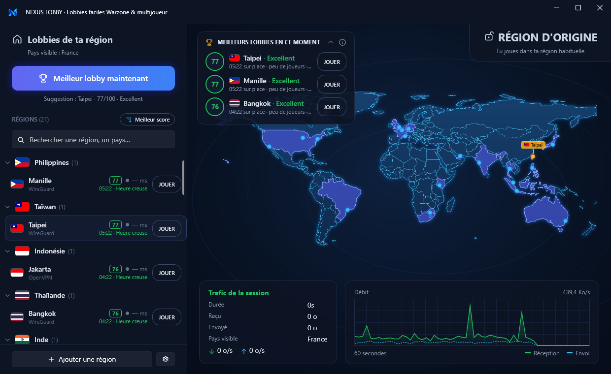
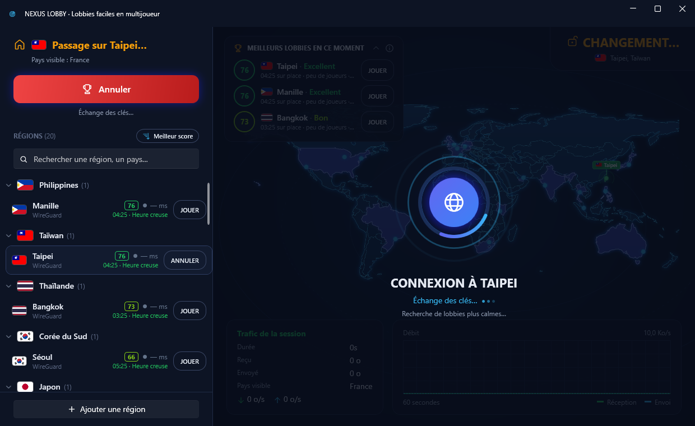
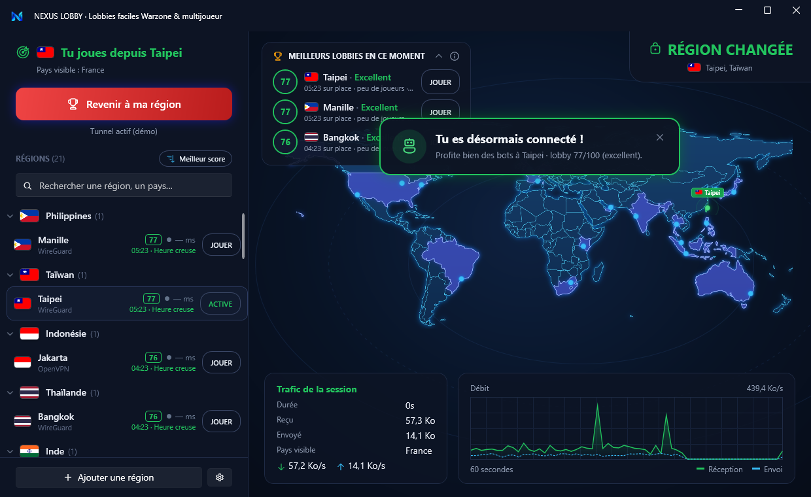

# NEXUS LOBBY

[](../../actions/workflows/ci.yml)


🇫🇷 [Version française](README.md)



**Region switcher for online gaming**: connect in one click to a VPN server in another country to play in lobbies
that are often quieter. The app scores every region live (local time, player population, ping) and suggests the
best one right now. Built for online shooters such as *Call of Duty: Warzone* and *Call of Duty* multiplayer.

> The user interface is currently in French only.

- 🌍 **Glowing world map**: highlighted countries, one marker per city, flags
- 🏆 **Live suggestions**: a 0–100 score per region, refreshed every minute
- ⚡ **WireGuard and OpenVPN**: import your `.conf` / `.ovpn` files, organized by country and city
- 📈 **Session**: duration, data used, live 60-second throughput graph
- 🔔 **System tray**: keeps running with the window closed, state-colored icon, Windows notifications
- 🔁 **Auto-reconnect** when the tunnel drops (3 tries max), and at Windows startup if you were connected
- 📂 **Drag & drop** several profiles at once; ⏳ **expiry date** for free accounts; 🔑 OpenVPN credentials **remembered** (encrypted)
- 🛡️ **Safe by default**: dangerous profiles rejected, tunnel removed automatically if the server doesn't answer
- 🔒 **Privacy**: no telemetry, never shows your IP or city (only the country you appear from)

> **Disclaimer.** NEXUS LOBBY is not affiliated with, endorsed or sponsored by Activision or any other publisher.
> *Call of Duty* and *Warzone* are trademarks of Activision Publishing, Inc. Switching regions gives **no guarantee**
> of easier lobbies: matchmaking mostly depends on connection quality and skill. Using a VPN to influence matchmaking
> may break some games' terms of service: **use at your own risk**.

## Preview

| Switching region | Connected |
|---|---|
|  |  |

*Screenshots taken with the demo servers (development mode).*

## Install

1. Download `NexusLobby-Setup-x.y.z.exe` from [Releases](../../releases) and run it (admin rights required: the app
   installs a Windows service).
2. Install [WireGuard](https://www.wireguard.com/install/) and/or [OpenVPN Community 2.6+](https://openvpn.net/community-downloads/)
   depending on your profiles.
3. In the app: **Ajouter une région** (add a region) → pick a `.conf` (WireGuard) or `.ovpn` (OpenVPN) file, one per country.

The app does not provide servers: use a provider that offers WireGuard / OpenVPN files, or your own servers.

## How regions are scored

Each region gets a 0–100 score (`src/VpnClient.App/Services/LobbyAdvisor.cs`):

| Criterion | Weight | Details |
|---|---|---|
| Server local time | 45 % | Low around 3–8 AM, peak around 7–11 PM, local time |
| Country player population | 25 % | Estimate: small, medium or large |
| Ping to the server | 20 % | < 80 ms ideal, > 150 ms penalized and flagged |
| Day of week | 10 % | Monday–Thursday quieter than Friday night and weekends |

Why: with fewer players online, matchmaking relaxes its criteria to keep queue times short. But publishers
prioritize connection quality: too much ping can cancel the effect or send you back to your own region.
**It's an estimate, not a guarantee.**

## Security

The service runs as SYSTEM (it creates network adapters); the UI runs without privileges.

- The app ↔ service pipe only accepts sessions logged on to the PC (no network access).
- Imported profiles are checked: scripts (`up`, `PostUp`…), DLLs (`plugin`, `engine`…) and references to files on
  disk are rejected (certificates and keys must be inlined in the profile).
- OpenVPN runs with `--script-security 1`; its management interface is protected by a random password.
- If a server doesn't answer (20 s for WireGuard, 30 s for OpenVPN), the tunnel is removed so your connection isn't blocked.
- Profiles are stored in `%ProgramData%\VpnClient\profiles`, readable by SYSTEM and administrators only.

Found a vulnerability? See [SECURITY.md](SECURITY.md) — please don't open a public issue.

## Privacy

No telemetry. The only Internet request (outside tunnels) goes to `ipinfo.io` to show the country you appear
from; the app keeps only the country code. Ping is measured directly to your servers.

## Development

Requirements: Windows 10/11, [.NET 10 SDK](https://dotnet.microsoft.com/download).

```powershell
# Admin terminal: the service in console mode (demo mode on in Development)
dotnet run --project src/VpnClient.Service

# Second terminal: the UI
dotnet run --project src/VpnClient.App

# Tests
dotnet test
```

In Development (`appsettings.Development.json`), profiles whose id starts with `demo-` simulate connections without
WireGuard or OpenVPN; `…-fail-unreachable`, `…-fail-auth`, `…-fail-lost` simulate failures.

Publish: `.\scripts\publish.ps1` (files in `dist\`, plus the installer if Inno Setup 6 is installed).
Release: pushing a `vX.Y.Z` tag builds the installer on GitHub (draft release).

Want to contribute? See [CONTRIBUTING.md](CONTRIBUTING.md).

## License

[PolyForm Noncommercial 1.0.0](LICENSE): free to use, modify and share for any **noncommercial** purpose.
**Selling it or any commercial use is forbidden** without written permission from the authors. This is therefore
not an OSI "open source" license: the code is public, but not reusable to make money.

Third-party components keep their own licenses: see [THIRD-PARTY-NOTICES.md](THIRD-PARTY-NOTICES.md).
